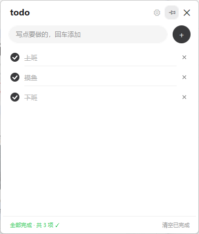
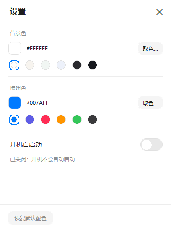

# todo · 桌面待办小卡片

一张贴在桌面上的极简待办卡片。单文件、无安装包、双击即用。





---

## 一、前置条件（必读）

### 1. 操作系统
- **Windows 10 / Windows 11**（64 位）
- 圆角窗口特效需要 Win11（Win10 上能用，只是没有圆角，不影响功能）

### 2. Python 运行环境（唯一的硬性依赖）
| 项目 | 要求 |
| --- | --- |
| Python 版本 | **3.8 及以上**（开发验证于 3.13.6） |
| 必须组件 | **tkinter**（Python 官方安装包默认自带） |
| 网络 | 无需联网，纯本地运行 |

可选依赖 `Pillow` 若安装，建议 **8.2 及以上**（圆角绘制用到 `ImageDraw.rounded_rectangle`）；更老的版本会自动退化为无抗锯齿画法，不会报错。

> **重要：不要用 Microsoft Store 版 Python。**
> 商店版对文件关联和注册表自启动有限制，容易踩坑。请用 [python.org](https://www.python.org/downloads/windows/) 的官方安装包。

安装时务必勾选这两项：

```
☑ Add python.exe to PATH
☑ tcl/tk and IDLE        ← 在 Optional Features 里，默认已勾选
```

### 3. 可选依赖：Pillow（强烈建议装）
卡片的圆角、抗锯齿圆圈、悬浮阴影都靠 Pillow 渲染。

- **装了**：边缘平滑，视觉最佳（推荐）
- **没装**：程序照样能跑，只是圆角退化为硬边、圆形有轻微锯齿

```bash
pip install pillow
```

> 装了多个 Python 时，`pip install` 可能装到了另一个版本上。用**目标解释器自己**来装最稳妥：
> ```bash
> "C:\Users\<你的用户名>\AppData\Local\Programs\Python\Python313\python.exe" -m pip install pillow
> ```

### 4. 无需安装的东西
以下都不需要：Node.js、Java、数据库、.NET SDK、任何第三方 GUI 框架。

---

## 二、快速开始

### 方式 A：直接运行（推荐）
1. 把 `待办卡片.pyw` 放到任意位置（桌面最方便）
2. **双击它**

`.pyw` 后缀在安装了 Python 的 Windows 上会自动交给 `pythonw`（无控制台解释器）执行，所以**不会弹出黑色命令行窗口**。

> 如果双击后毫无反应，先看下面的「⚠️ 装了多个 Python 版本时注意」，再查「五、常见问题 → 双击没反应」。

### 方式 B：命令行运行（排查问题时用）
```bash
# 正常启动
pythonw "待办卡片.pyw"

# 带控制台启动，能看到报错信息
python "待办卡片.pyw"
```

### ⚠️ 装了多个 Python 版本时注意

Windows 上 `.pyw` 通常关联到 **Python 启动器 `pyw.exe`**（不是直接指向某个 `pythonw.exe`），它会在你安装的多个版本里挑一个来跑。常见后果：双击后**静默退出、毫无反应**——因为被挑中的那个 Python 没装 tkinter，而 `pythonw` 没有控制台，报错看不见。

确认 `.pyw` 实际用的是哪个解释器：

```bash
reg query "HKCR\Python.NoConFile\shell\open\command"
```

若输出的不是你想用的版本，有两个办法：

**办法一（推荐）**：给脚本指定解释器。新建一个 `启动待办卡片.bat` 放在桌面：

```bat
@echo off
start "" "C:\Users\<你的用户名>\AppData\Local\Programs\Python\Python313\pythonw.exe" "%~dp0待办卡片.pyw"
```

（把路径换成你确认过「装有 tkinter + Pillow」的那个 `pythonw.exe`）

**办法二**：把 `.pyw` 关联改指向指定 `pythonw.exe`：右键脚本 → 打开方式 → 选择其他应用 → 更多应用 → 在这台电脑上查找 → 选 `pythonw.exe` → 勾选「始终使用此应用打开」。

> 本机当前环境已确认可用：`pyw.exe` → Python 3.13.6（tkinter 8.6 + Pillow 11.3.0），双击正常。

### 开机自启
不用手动配置。打开卡片 → 点右上角 **⚙ 设置** → 打开「开机自启动」开关即可。
它会在注册表写入（当前用户级，不需要管理员权限）：

```
HKCU\Software\Microsoft\Windows\CurrentVersion\Run
  值名：TodoCard
```

关闭开关即从注册表移除，无残留。

> 注意：自启写入的是**启动时实际在用的那个 `pythonw.exe` 的绝对路径**。如果你之后换了 Python 版本、或把脚本挪了位置，重新开关一次自启开关即可修正。

---

## 三、功能一览

**待办操作**
- 底部输入框写内容，**回车**或点右侧 **＋** 新增
- 点左侧圆圈切换完成 / 未完成
- **双击文字**直接编辑；点卡片上任意别处即自动保存
- 行尾 **✕** 删除单条
- 按住任意一条**上下拖动**可调整顺序（拿起跟随指针、松手落位，原位置显示灰色槽位）
- 右键任意一条：**复制** / 编辑 / 标记 / 删除
- **Ctrl + Z** 撤销最近一次删除或「清空已完成」（会恢复原始位置）
- 状态栏一键「清空已完成」

**窗口**
- 无边框卡片，**按住标题栏拖动**移动位置
- **拖四条边或四个角**可任意缩放（最小 300 × 240）
- 位置和尺寸自动记住
- 右上角：**⚙ 设置** · **📌 置顶开关** · **✕ 关闭**
- 列表内容一页装得下时**固定不滚动**；装不下才会出现滚动

**外观设置**（点 ⚙）
- **背景色 / 按钮色**：各 6 个预设色块 + 系统取色器（可选任意颜色），改完即时生效
- 其余配色（文字、分隔线、悬停、阴影等）全部由这两个颜色**自动推导**，深色底会自动切成浅色文字，不会出现「选个色就看不清字」
- **不透明度**：滑块 40%–100%，拖动实时预览
- 「恢复默认配色」一键还原

**文件位置**

| 内容 | 路径 |
| --- | --- |
| 待办数据 | `%APPDATA%\TodoCard\todo_data.json` |
| 运行日志 | `%APPDATA%\TodoCard\todo_card.log` |

> 数据放在 `%APPDATA%` 而不是脚本旁边，所以**脚本可以随便挪位置**，数据不会丢。

---

## 四、环境自检

想知道当前机器是否满足要求，在命令行运行：

```bash
python -c "import sys,tkinter;print('Python',sys.version);print('Tk',tkinter.TkVersion)"
python -c "import PIL;print('Pillow',PIL.__version__)"
```

正常输出类似：

```
Python 3.13.6 ...
Tk 8.6
Pillow 11.3.0
```

脚本自带端到端自检（会短暂弹窗、自动执行增删改与拖动，然后自动关闭，**不会碰你的真实数据**）：

```bash
python "待办卡片.pyw" --selftest
```

成功会打印：

```
SELFTEST OK  PIL=True  icon=True  数据目录=C:\Users\<你>\AppData\Roaming\TodoCard
```

---

## 五、常见问题

### 双击没反应
按顺序排查：

1. **被启动器挑中了错误的 Python**（装了多个版本时最常见）。命令行跑 `python "待办卡片.pyw"` 看是否报 `No module named 'tkinter'`；是的话按上面「⚠️ 装了多个 Python 版本时注意」处理。
2. **看日志**：打开 `%APPDATA%\TodoCard\todo_card.log`，最后几行通常就是原因。
3. **已经开着一个了**：程序是单实例的，再次双击不会开第二个窗口，而是把已有卡片拉到最前。若旧实例卡住，在任务管理器结束 `pythonw.exe` 再试。
4. **`.pyw` 关联丢了**：右键 `待办卡片.pyw` → 打开方式 → 选择其他应用 → 找到 `pythonw.exe`（在 Python 安装目录下）→ 勾选「始终使用此应用打开」。
5. **用命令行跑**：`python "待办卡片.pyw"`，报错会直接显示在窗口里。

### 提示 `ModuleNotFoundError: No module named 'tkinter'`
你的 Python 安装时没勾 tcl/tk。重装 Python，在 Optional Features 里勾上 **tcl/tk and IDLE**。

### 界面圆角发硬、圆圈有锯齿
没装 Pillow。执行 `pip install pillow` 后重开即可。

### 图标显示成方块或奇怪字符
系统缺少 `Segoe MDL2 Assets` 字体（Win10/11 自带）。缺失时程序会自动退化为文字符号（置顶/✕/⚙），不影响使用。

### 卡片不见了 / 跑到屏幕外
拔掉外接显示器后可能出现。程序启动时会检测记忆的位置是否还在可视区域，不在就自动回到默认位置。若仍看不到，删掉 `todo_data.json` 里的 `pos` 字段再开。

### 想重置所有数据
删除 `%APPDATA%\TodoCard\todo_data.json` 即可（日志文件可一并删）。

### 想彻底卸载
1. 设置里关闭「开机自启动」（或删除注册表 `HKCU\...\Run\TodoCard`）
2. 删除 `待办卡片.pyw`
3. 删除 `%APPDATA%\TodoCard\` 整个文件夹

---

## 六、技术说明（给想改代码的人）

- **语言 / 框架**：Python + tkinter（Tk 8.6），单文件 2000+ 行，零第三方强制依赖
- **无边框窗口**：`overrideredirect(True)` + 自绘标题栏和八向缩放热区
- **抗锯齿**：圆角矩形与圆形用 Pillow 4–6 倍超采样后 LANCZOS 缩放，带图片缓存（FIFO 逐出）
- **数据持久化**：JSON，写临时文件 + `os.replace` 原子替换，避免写一半损坏
- **单实例**：命名互斥量 `WorkBuddyTodoCardMutex`
- **置顶**：Tk `-topmost` + Win32 `SetWindowPos(HWND_TOPMOST)` 双保险
- **透明度**：Tk `-alpha`
- **圆角窗口**：DWM `DWMWA_WINDOW_CORNER_PREFERENCE`（Win11 生效）
- **高 DPI**：`SetProcessDpiAwareness(1)`，避免高分屏发虚
